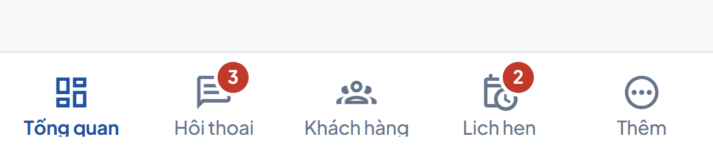
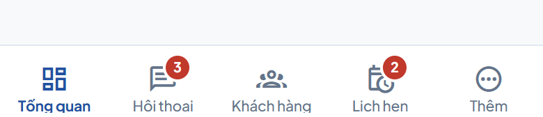
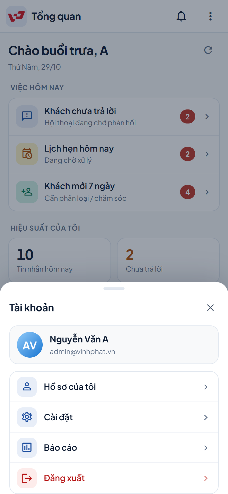
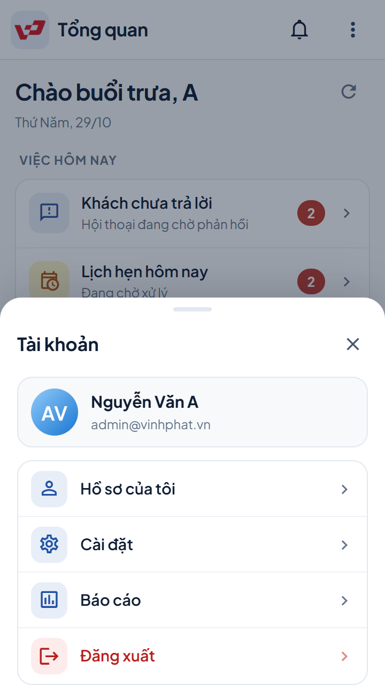
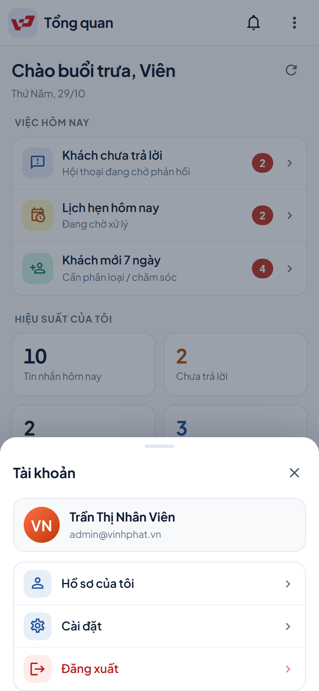
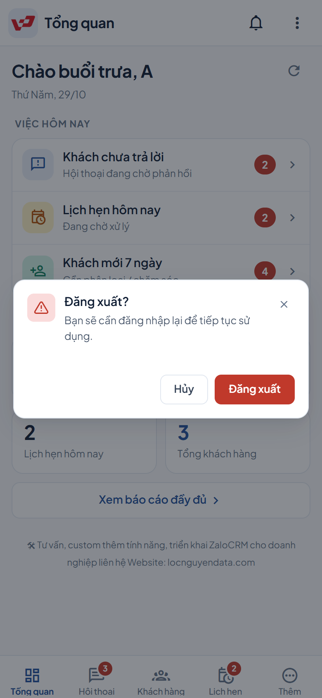
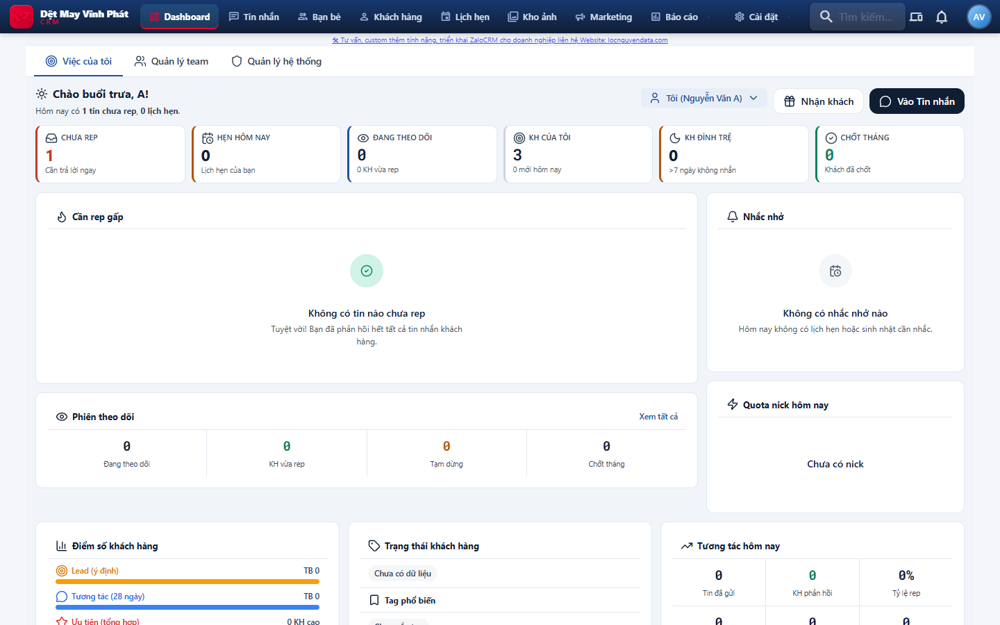

# Biên bản nghiệm thu — Bottom nav & sheet tài khoản (mobile)

| | |
|---|---|
| Dự án | Vĩnh Phát CRM (`ZaloCRM`) |
| Hạng mục | Tinh chỉnh bottom navigation 5 tab và bottom sheet tài khoản cho mobile |
| Ngày nghiệm thu | 29/10/2026 |
| Commit bàn giao | `2bc6df27` — `fix(mobile): thu gọn bottom nav và kéo sheet tài khoản sát đáy` |
| Nhánh / remote | `main` → `origin/main` (đã push) |
| Người thực hiện | OpenCode Agent |
| Môi trường đo | Chrome (Playwright), build production `vite preview` tại `http://localhost:4173`, API mock |
| Kết quả tổng | **39/39 kiểm tra tự động PASS**, **26/26 unit test PASS**, build + typecheck PASS |

> Phạm vi: chỉ thay đổi giao diện mobile (nav + sheet tài khoản). Không đổi API, DB, quyền, hay luồng nghiệp vụ.

---

## 1. Kết luận nghiệm thu

- Bottom nav cao **52px** (trước 56px), nội dung canh sát đáy, label cách mép dưới **3px**.
- Sheet tài khoản kết thúc **sát đáy màn hình**; hàng cuối cách đáy panel **1px** (trước 16–17px).
- Toàn bộ vùng chạm đạt tối thiểu 44px: tab **52×78px**, hàng menu **52px**, nút đóng **44×44px**.
- 4 mục trong sheet hoạt động đúng: Hồ sơ, Cài đặt, Báo cáo, Đăng xuất (có xác nhận).
- Tài khoản nhân viên không thấy mục Báo cáo.
- Desktop không bị ảnh hưởng, không tràn ngang, không lỗi console.

**Đạt điều kiện bàn giao**, kèm 1 bước kiểm tra cảm giác chạm trên thiết bị thật (mục 7).

---

## 2. Nội dung thay đổi bàn giao

| File | Thay đổi | Tác dụng |
|---|---|---|
| `frontend/src/components/BottomNav.vue` | Nav `56px → 52px`; tab `justify-content: flex-end`; `padding-bottom: 4px` | Thanh nav gọn, label áp sát đáy, không bị lửng |
| `frontend/src/components/mobile/MobileSheet.vue` | Thêm prop `flush`; class `.msheet__body.is-flush { padding-bottom: 0 }` | Cho phép action sheet kéo danh sách sát đáy |
| `frontend/src/layouts/MobileLayout.vue` | `<MobileSheet ... flush>` cho sheet tài khoản | Chỉ sheet tài khoản dùng flush; các sheet khác giữ nguyên padding |

Vị trí tham chiếu:

- `BottomNav.vue:117` — `height: calc(52px + env(safe-area-inset-bottom, 0px))`
- `BottomNav.vue:127` — `justify-content: flex-end`
- `BottomNav.vue:129` — `padding-bottom: 4px`
- `MobileSheet.vue:28` — class `is-flush` theo prop
- `MobileSheet.vue:152` — panel vẫn giữ `padding-bottom: env(safe-area-inset-bottom, 0px)`
- `MobileSheet.vue:209` — `.msheet__body.is-flush { padding-bottom: 0 }`
- `MobileLayout.vue:56` — sheet tài khoản dùng `flush`

---

## 3. Bằng chứng trước / sau

### 3.1 Số đo

| Hạng mục | Trước (build cũ) | Sau (commit `2bc6df27`) | Kỳ vọng |
|---|---:|---:|---|
| Chiều cao bottom nav | 56px | **52px** | Gọn hơn, vẫn ≥ 44px |
| Canh nội dung tab | center | **flex-end** | Sát đáy |
| Label → mép dưới nav | 8.8px | **3px** | ≤ 4px |
| Icon → mép trên nav | 10.8px | **12.5px** | Thoáng, không cắt |
| Hàng cuối sheet → đáy panel | 16–17px | **1px** | ≤ 2px |
| Body sheet padding-bottom | 16px | **0px** | Sát đáy |
| Panel sheet → đáy viewport | 0px | **0px** | 0px |

Nguồn số đo "trước": log đo tại thời điểm 13:19–13:24 ngày 29/10/2026, trước khi áp dụng CSS mới.
Số đo "sau": `assets/evidence.json` (sinh lúc 13:50 ngày 29/10/2026).

### 3.2 Ảnh nav trước / sau (390×844)

| Trước | Sau |
|---|---|
|  |  |
| Label còn cách đáy 8.8px, nội dung canh giữa | Label cách đáy 3px, nav cao 52px, sát đáy |

> Ảnh "trước" được chụp từ build trước khi sửa trong cùng phiên làm việc; không chỉnh sửa hay dàn dựng lại.

### 3.3 Sheet tài khoản sau khi sửa



- Panel: `top 482 → bottom 844` (cao 362px), đáy trùng đáy viewport.
- Hàng "Đăng xuất" kết thúc tại `y=843`, cách đáy panel 1px.
- Không cần cuộn: `bodyScrolls: false`.

### 3.4 Màn hình nhỏ 360×640



- Panel: `top 278 → bottom 640`, vẫn đủ 4 mục, hàng cuối hiển thị trọn vẹn.
- Không tràn ngang, không cắt nội dung.

### 3.5 Tài khoản nhân viên (không có mục Báo cáo)



- Chỉ còn: Hồ sơ của tôi, Cài đặt, Đăng xuất.

### 3.6 Xác nhận đăng xuất và desktop

| Xác nhận đăng xuất (z-index 4000) | Desktop 1440×900 (không có mobile shell) |
|---|---|
|  |  |

---

## 4. Ma trận kiểm thử tự động

Chạy bằng Playwright trên build production; dữ liệu API được mock đầy đủ theo DTO.

| Nhóm | Nội dung | Kết quả |
|---|---|---|
| 390×844 | 5 tab, nav sát đáy, tab ≥ 44px, label ≤ 4px, sheet trong viewport, hàng cuối ≤ 2px, không tràn ngang | 9/9 PASS |
| 360×740 | Cùng bộ kiểm tra | 9/9 PASS |
| 360×640 | Cùng bộ kiểm tra | 9/9 PASS |
| Tương tác | Mở sheet, chạm backdrop đóng + mở khoá cuộn, Hồ sơ → `/profile`, Cài đặt → `/settings/rbac/users`, Báo cáo → `/reports/tong-quan` | 5/5 PASS |
| Đăng xuất | Confirm z-index 4000, huỷ giữ phiên, xác nhận về `/login` + xoá token | 3/3 PASS |
| Phân quyền | Staff không thấy mục Báo cáo | 1/1 PASS |
| Desktop | Không render `.m-shell`/`.m-nav`, không tràn ngang, không lỗi console | 3/3 PASS |
| **Tổng** | | **39/39 PASS** |

Chi tiết từng assertion: [`assets/evidence.json`](assets/evidence.json).

---

## 5. Cổng chất lượng

| Cổng | Lệnh | Kết quả | Log |
|---|---|---|---|
| Typecheck + build | `npm run build` (gồm `vue-tsc -b`) | PASS — built in 9.04s | [`assets/build-output.txt`](assets/build-output.txt) |
| Unit test | `npm test` | PASS — 2 files, **26/26 tests** | [`assets/test-output.txt`](assets/test-output.txt) |
| Kiểm thử UI | Playwright, 5 ngữ cảnh | PASS — 39/39 | [`assets/evidence.json`](assets/evidence.json) |

---

## 6. Danh mục bằng chứng bàn giao

| Tệp | Nội dung |
|---|---|
| `assets/evidence.json` | Toàn bộ số đo + 39 assertion + lỗi console |
| `assets/build-output.txt` | Log build/typecheck |
| `assets/test-output.txt` | Log Vitest |
| `assets/before-nav-390.png` | Nav trước khi sửa |
| `assets/nav-390x844.png` | Nav sau khi sửa |
| `assets/sheet-390x844.png` | Sheet tài khoản chuẩn |
| `assets/sheet-360x640.png` | Sheet trên màn hình nhỏ |
| `assets/sheet-staff-390x844.png` | Sheet tài khoản nhân viên |
| `assets/logout-confirm-390x844.png` | Hộp thoại xác nhận đăng xuất |
| `assets/desktop-1440x900.png` | Desktop không hồi quy |

---

## 7. Checklist nghiệm thu trên thiết bị thật

Thực hiện trên Chrome Android hoặc Safari iOS, bản build từ commit `2bc6df27`:

- [ ] Đăng nhập, thấy thanh nav 5 tab nằm sát đáy, không có khoảng trắng thừa.
- [ ] Label 5 tab không bị cắt, không chồng lên icon; tab đang chọn nổi bật.
- [ ] Chạm lần lượt 5 tab: đúng màn hình, badge hội thoại/lịch hẹn vẫn hiển thị.
- [ ] Mở sheet tài khoản: 4 mục hiển thị đủ, hàng "Đăng xuất" sát đáy nhưng **nằm trên vạch home indicator** (iPhone).
- [ ] Bấm Hồ sơ / Cài đặt / Báo cáo: chuyển trang đúng, sheet đóng.
- [ ] Bấm Đăng xuất: hộp xác nhận nổi lên trên sheet; Huỷ giữ phiên; Đồng ý về trang đăng nhập.
- [ ] Đăng nhập tài khoản nhân viên: sheet không có mục Báo cáo.
- [ ] Mở app ở chế độ dọc và xoay ngang: không tràn ngang, nav không đè nội dung.
- [ ] Trên iPhone: vùng an toàn đáy được tôn trọng, không bấm nhầm home indicator.

---

## 8. Giới hạn & lưu ý

1. **API mock**: số đo và tương tác được kiểm tra với API giả lập đầy đủ DTO; chưa chạy với backend/credentials thật trong phiên này.
2. **Safe-area**: Chromium desktop không mô phỏng `env(safe-area-inset-bottom)`. Đã xác nhận bằng mã nguồn (`MobileSheet.vue:152`, `BottomNav.vue:117`); cần kiểm tra trực quan trên iPhone thật (mục 7).
3. **Trình duyệt**: đo trên Chromium. Safari iOS có thể sai khác nhỏ về `dvh`; cần xác nhận trên thiết bị thật.
4. Không thay đổi DB, API, quyền hay dữ liệu — không cần migration/rollback dữ liệu.

---

## 9. Rollback

Nếu cần hoàn tác:

```powershell
git revert 2bc6df27
```

Hoặc checkout lại 3 file tại commit `59eeef9b`. Không ảnh hưởng dữ liệu.

---

## 10. Ký nhận

| Vai trò | Họ tên | Ngày | Kết quả | Ký tên |
|---|---|---|---|---|
| Người thực hiện (OpenCode Agent) | — | 29/10/2026 | Đã bàn giao | — |
| Người nghiệm thu (Chủ dự án) |  |  | ☐ Đạt  ☐ Cần chỉnh |  |
| Đại diện vận hành |  |  | ☐ Đạt  ☐ Cần chỉnh |  |

---

*Biên bản được tạo tự động từ kết quả kiểm thử thực tế. Mọi số liệu đều truy vết được về `assets/evidence.json` và log tương ứng.*
