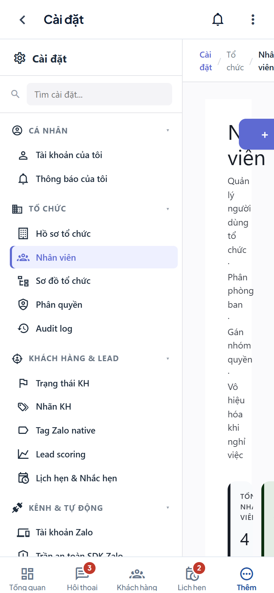
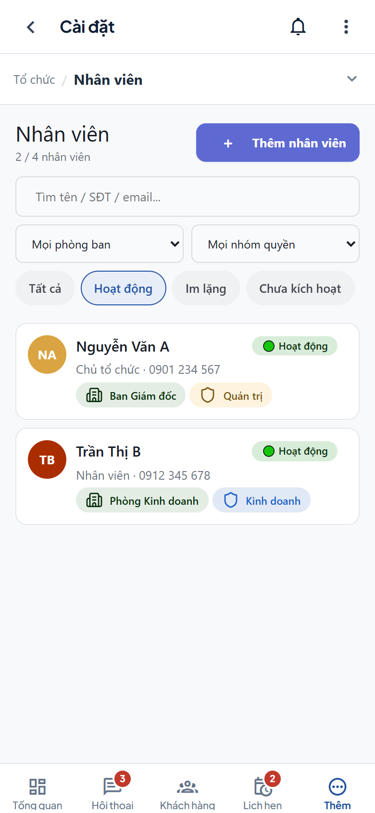
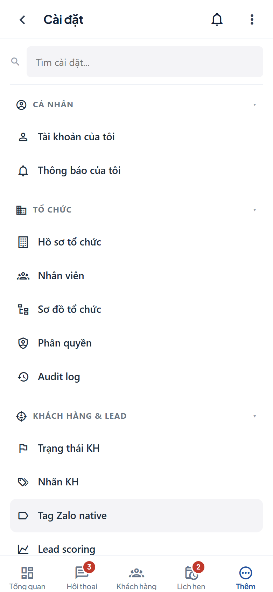
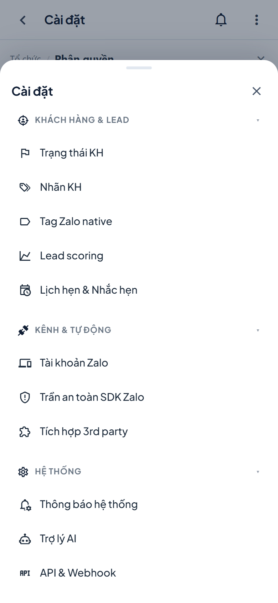
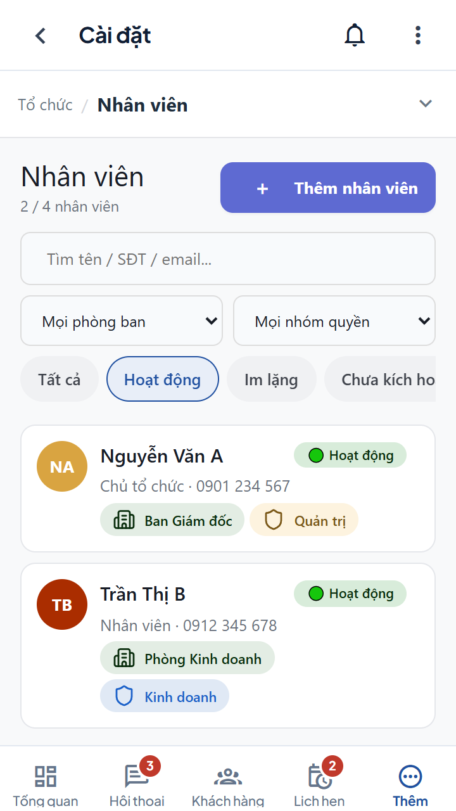
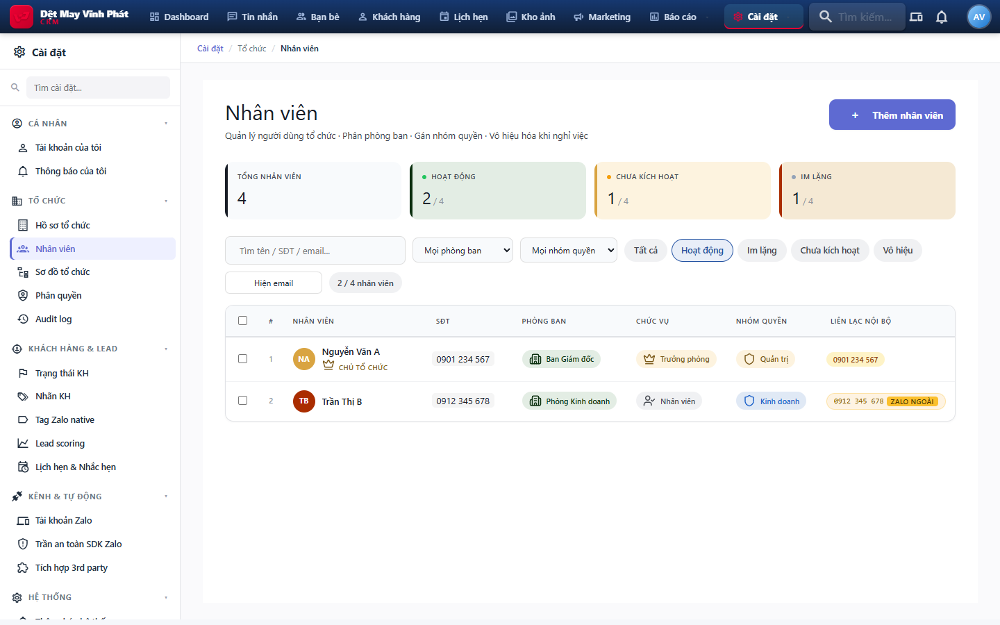
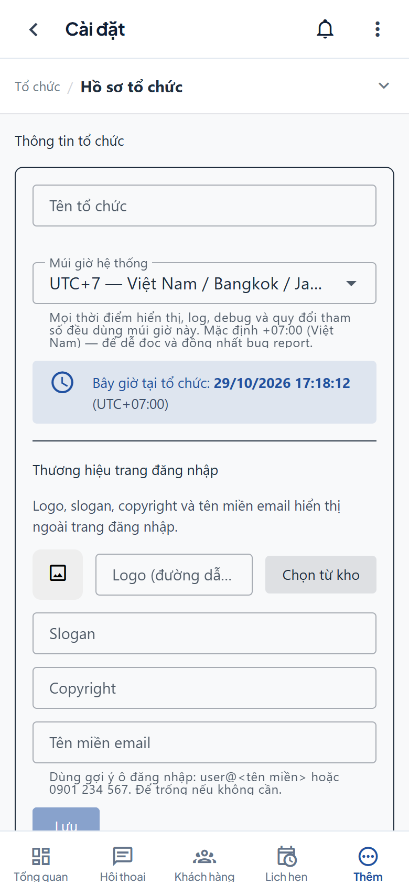
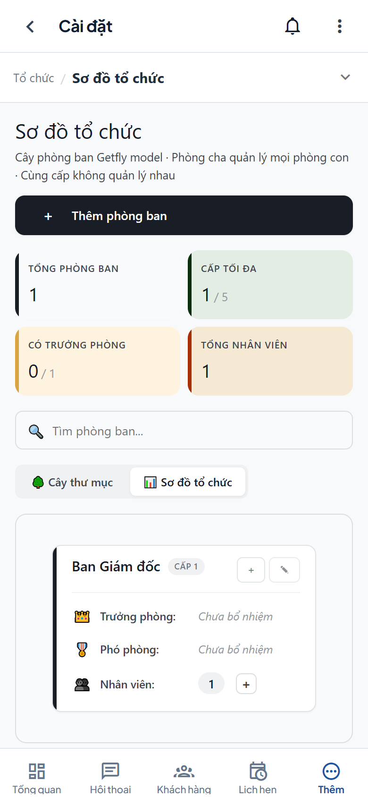
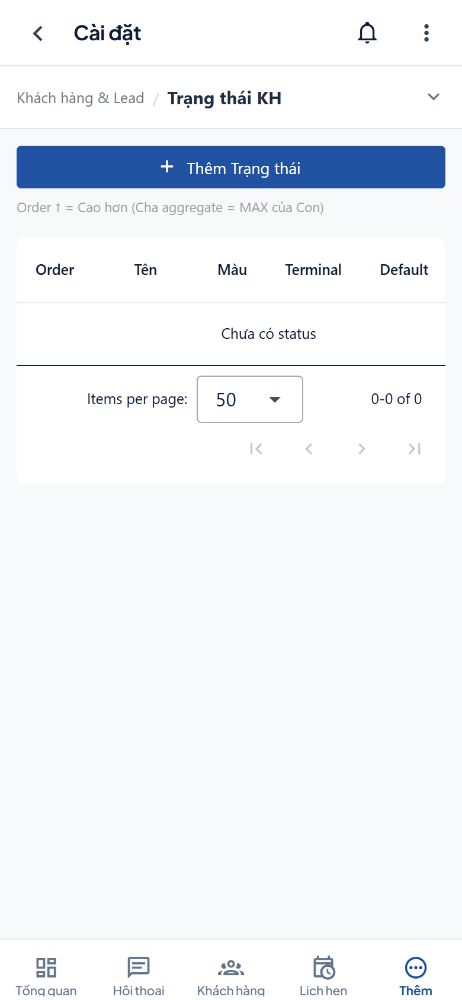
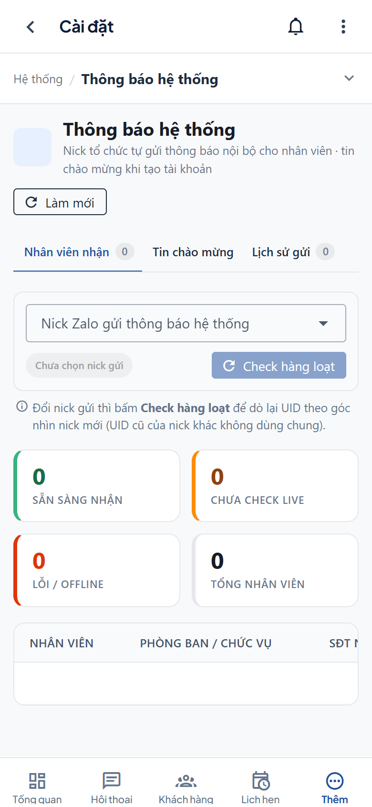

# Biên bản nghiệm thu — Trang Cài đặt trên mobile

| | |
|---|---|
| Dự án | Vĩnh Phát CRM (`ZaloCRM`) |
| Hạng mục | Sửa layout trang Cài đặt trên mobile: bỏ sidebar 260px, trang danh mục, bottom sheet đổi mục, danh sách nhân viên dạng card |
| Ngày nghiệm thu | 29/10/2026 |
| Commit bàn giao | `0fa8fe3e` — `fix(mobile): sửa layout trang Cài đặt và danh sách nhân viên` |
| Nhánh / remote | `main` → `origin/main` |
| Người thực hiện | OpenCode Agent |
| Môi trường đo | Chrome (Playwright), build production `vite preview` tại `http://localhost:4173`, API mock |
| Triển khai production | **29/10/2026 17:33–17:34 ICT** — `http://103.213.216.31:3090`, commit `8c78c47a`, script `./scripts/zalocrm-deploy.sh upgrade` |
| Kết quả tổng | **10/10 kiểm tra tương tác PASS**, **18/18 route Cài đặt không tràn ngang**, **26/26 unit test PASS**, build + typecheck PASS, production **health OK / asset khớp** |

> Phạm vi: chỉ thay đổi giao diện mobile của khu vực Cài đặt. Không đổi API, DB, quyền, luồng nghiệp vụ hay identifier nội bộ.

---

## 1. Kết luận nghiệm thu

- Trên mobile, sidebar 260px **không còn render**; nội dung chiếm toàn bộ chiều rộng (390/390px thay vì 130px).
- `/settings` trở thành **trang danh mục** 18 mục, không tự nhảy vào một mục con.
- Trang con có thanh sticky `nhóm / mục`; chạm vào mở **bottom sheet** đổi mục, có tìm kiếm và cuộn tới mục cuối.
- Nút back trên app bar từ `/settings/*` quay về **trang danh mục** `/settings`.
- Danh sách Nhân viên dùng **card list** trên mobile; bảng desktop 1332px được ẩn, không còn bị cắt.
- Các trang từng vỡ khác đã được chỉnh: Hồ sơ tổ chức, Sơ đồ tổ chức, Trạng thái KH, Thông báo hệ thống.
- Desktop không hồi quy: sidebar 260px, breadcrumb, bảng nhân viên và redirect `/settings` giữ nguyên.
- Không tràn ngang toàn cục, không lỗi console/page error trong 18 route được quét.
- Đã triển khai lên production `http://103.213.216.31:3090` lúc **17:34 ngày 29/10/2026** (commit `8c78c47a`); health `ok`, DB `connected`, asset phục vụ đúng hash (mục 6).

**Đạt điều kiện bàn giao**, kèm 1 bước kiểm tra cảm giác chạm trên thiết bị thật (mục 8).

---

## 2. Nội dung thay đổi bàn giao

| File | Thay đổi | Tác dụng |
|---|---|---|
| `frontend/src/components/settings/SettingsNavPanel.vue` | **Mới** — panel nav dùng chung: search, group thu gọn, active state, touch target 44–48px | Sidebar desktop, trang danh mục mobile và bottom sheet dùng cùng một nguồn |
| `frontend/src/views/settings/SettingsLayout.vue` | Mobile bỏ sidebar; `/settings` là hub; thanh sticky đổi mục; bottom sheet; back về hub | Nội dung full width, điều hướng Cài đặt rõ ràng trên điện thoại |
| `frontend/src/layouts/MobileLayout.vue` | `goBack()` đưa `/settings/*` về `/settings` | Không bị thoát app khi mở bằng deep link |
| `frontend/src/views/rbac/UsersRbacView.vue` | Card list mobile, hero gọn, chip lọc cuộn ngang, ẩn stats trùng lặp; bảng desktop giữ nguyên | Danh sách nhân viên đọc được trên màn hình 360–390px |
| `frontend/src/views/rbac/DepartmentsView.vue` | Media query mobile: hero gọn, thống kê 2×2 | Hết chữ dọc trong 4 cột thống kê |
| `frontend/src/components/settings/OrgSettings.vue` | Form full width; ẩn preview đăng nhập 880px trên mobile | Form không còn bị cắt |
| `frontend/src/components/settings/StatusManagement.vue` | Toolbar xuống dòng, nút tạo full width, hint xuống dưới | Nút không còn đè mô tả `Order` |
| `frontend/src/views/settings/SystemNotificationsPage.vue` | Tab gọn, hint bọc đúng, select/hint/nút check vừa màn hình | Hết cắt tab và chữ cột |
| `frontend/src/assets/rbac-page.css` | Media query chung cho `.dept-page`, `.page-hero`, `.stats-row` | Các trang RBAC khác có nền tảng mobile thống nhất |

Vị trí tham chiếu:

- `SettingsLayout.vue` — `isMobile`, `isMobileHome`, `navOpen`, `sl-mobile-head`, `MobileSheet`
- `SettingsNavPanel.vue` — `visibleGroups`, `searchItems`, `.snp.is-mobile`
- `UsersRbacView.vue` — `.ur-mobile-list`, `.ur-card`, media query `max-width: 767px`
- `MobileLayout.vue` — `goBack()` nhánh `route.path.startsWith('/settings/')`

---

## 3. Bằng chứng trước / sau

### 3.1 Số đo

| Hạng mục | Trước | Sau | Kỳ vọng |
|---|---:|---:|---|
| Sidebar trên mobile | 260px | **0** (không render) | Biến mất |
| Bề rộng nội dung | 130px | **390px** | Toàn bộ viewport |
| Bề rộng hero | 2px | **358px** | Đọc được tiêu đề + mô tả |
| Bảng nhân viên | 1332px, wrap client 0px, `overflow: hidden` | **bảng ẩn, card 358px** | Không cắt dữ liệu |
| Trang `/settings` mobile | redirect sang mục mặc định | **hub 18 mục** | Xem được toàn bộ danh mục |
| Cuộn ngang | `contentScrollW 324 > clientW 130` | `docScrollW 390 = vw` | Không tràn |
| 360×640: card đầu | — | **y=335, rộng 328px** | Danh sách lên sớm, không tràn |
| 360×640: mục cuối hub | — | **đáy 554 < nav 588** | Không bị nav che |

Nguồn số đo "trước": [`assets/before-metrics.json`](assets/before-metrics.json) — chụp đúng trạng thái trong ảnh người dùng gửi.
Số đo "sau": [`assets/evidence.json`](assets/evidence.json), sinh lúc 17:17 ngày 29/10/2026.

### 3.2 Nhân viên trước / sau (390×844)

| Trước | Sau |
|---|---|
|  |  |
| Sidebar chiếm 260px, nội dung 130px, chữ vỡ dọc, bảng 1332px bị cắt | Không sidebar, hero gọn, chip lọc cuộn ngang, card list full width |

> Ảnh "trước" được chụp từ build trước khi sửa trong cùng phiên làm việc; khớp với ảnh người dùng gửi.

### 3.3 Trang danh mục Cài đặt (390×844)



- 18 mục thuộc 6 nhóm; mục đang xem được đánh dấu.
- Cuộn hết danh sách vẫn thấy mục cuối, không bị bottom nav che.

### 3.4 Bottom sheet đổi mục (390×844)



- Body sheet cao 686px, nội dung 1207px → cuộn được.
- Mục cuối `API & Webhook` cách đáy panel **17.6px**, nằm trọn trong viewport.
- Tìm kiếm trong sheet trả đúng kết quả và đóng sheet sau khi chọn.

### 3.5 Màn hình nhỏ 360×640 và desktop

| 360×640 | Desktop 1440×900 |
|---|---|
|  |  |
| Không tràn ngang, card 328px, thống kê ẩn | Sidebar 260px, breadcrumb, bảng nhân viên hiển thị |

### 3.6 Các trang Cài đặt khác sau khi chỉnh (390×844)

| Hồ sơ tổ chức | Sơ đồ tổ chức |
|---|---|
|  |  |
| Form full width, preview 880px ẩn | Thống kê 2×2, hero gọn |

| Trạng thái KH | Thông báo hệ thống |
|---|---|
|  |  |
| Nút tạo full width, hint xuống dòng | 3 tab vừa màn hình, hint và nick gửi không còn vỡ cột |

---

## 4. Ma trận kiểm thử tự động

Chạy bằng Playwright trên build production; dữ liệu API được mock đầy đủ theo DTO.

| Nhóm | Nội dung | Kết quả |
|---|---|---|
| Luồng vào | Tài khoản → Cài đặt mở `/settings` hub, không nhảy vào mục con | 1/1 PASS |
| Nhân viên mobile | Bảng ẩn, card hiện, nội dung 390px | 1/1 PASS |
| Bottom sheet | Tìm kiếm + chọn mục điều hướng đúng, sheet đóng | 1/1 PASS |
| Bottom sheet | Cuộn tới mục cuối, không bị cắt | 1/1 PASS |
| Điều hướng | Back app bar từ trang con về `/settings` | 1/1 PASS |
| Chi tiết | Chạm card mở panel nhân viên, panel 358.8px nằm trong viewport | 1/1 PASS |
| 360×640 | Không tràn ngang, card hiện, stats/bảng ẩn | 1/1 PASS |
| 360×640 | Hub cuộn tới mục cuối, không bị nav che | 1/1 PASS |
| Desktop | `/settings` redirect đúng, sidebar 260px, breadcrumb, bảng hiện | 1/1 PASS |
| Desktop | Không có mobile shell/nav, không tràn ngang | 1/1 PASS |
| **Tổng tương tác** | | **10/10 PASS** |

Quét toàn bộ route Cài đặt trên mobile (390×844):

| Hạng mục | Kết quả |
|---|---|
| Số route | 18 (gồm `/settings` hub) |
| Route tràn ngang toàn cục | **0** |
| Page error / lỗi console | **0** |
| Bảng rộng trong trang | Chỉ còn bảng nằm trong vùng `overflow-x: auto` (Trạng thái KH, Thông báo hệ thống) — cuộn ngang trong khung, không đẩy trang |

Chi tiết: [`assets/evidence.json`](assets/evidence.json) và [`assets/routes-sweep.json`](assets/routes-sweep.json).

---

## 5. Cổng chất lượng

| Cổng | Lệnh | Kết quả | Log |
|---|---|---|---|
| Typecheck + build | `npm run build` (`vue-tsc -b && vite build`) | PASS — built in 8.17s | [`assets/build-output.txt`](assets/build-output.txt) |
| Unit test | `npm test` | PASS — 2 files, **26/26 tests** | [`assets/test-output.txt`](assets/test-output.txt) |
| Kiểm thử UI | Playwright, 390×844 / 360×640 / 1440×900 | PASS — 10/10 | [`assets/evidence.json`](assets/evidence.json) |
| Quét route | Playwright, 18 route Cài đặt | PASS — 0 tràn ngang, 0 lỗi | [`assets/routes-sweep.json`](assets/routes-sweep.json) |

---

## 6. Xác minh trên production

Triển khai bằng `./scripts/zalocrm-deploy.sh upgrade` trên VPS `VinhPhat-VPS`, thư mục `/srv/zcrm`.

| Hạng mục | Giá trị |
|---|---|
| Thời điểm deploy | 29/10/2026 **17:33:27 → 17:34:54 ICT** (≈87 giây) |
| Commit trên VPS | `8c78c47a09f373461e2b4dd2a7776d414ba90d85` — `docs(acceptance): biên bản nghiệm thu trang Cài đặt mobile` |
| Working tree VPS | Sạch (0 file thay đổi) |
| Backup DB trước deploy | `backup-zalocrm-2026-10-29-1733.sql` — 7.943.015 bytes (7.6 MB) |
| Migration | `No pending migrations` — `Database schema is up to date!` |
| Container | `zalo-crm-app` (`7272109cd957…`), image `zcrm-app`, running `0.0.0.0:3090->3000/tcp` |
| Health | `GET /health` → `200` `{"status":"ok","db":"connected"}` |
| Trang đăng nhập | `GET /` → `200`, 3.844 bytes |

Asset do production phục vụ (tải qua HTTP và băm SHA-256 tại chỗ):

| Asset | HTTP | Bytes | SHA-256 | Marker |
|---|---:|---:|---|---|
| `assets/SettingsLayout-8ZKAh7sL.js` | 200 | 10.773 | `4534a24e…b41ca790` | `sl-mobile-head` ×5, `sl-mobile-home` ×1 |
| `assets/UsersRbacView-D2NbnHil.js` | 200 | 50.052 | `0e9b75a0…df99750` | `ur-card` ×10 |
| `assets/index-Dy35hqPI.js` | 200 | 373.641 | `aaa8767a…ba466dfb` | — |

Header mẫu của chunk Cài đặt:

```http
HTTP/1.1 200 OK
cache-control: public, max-age=0
last-modified: Thu, 29 Oct 2026 10:34:26 GMT
etag: W/"2a15-1a18739ab50"
content-type: application/javascript; charset=utf-8
content-length: 10773
```

Kiểm tra từ máy trạm qua IP công khai cho cùng kết quả: health `ok`, trang chủ `200`, hai chunk Settings/Users `200` và chứa marker tương ứng.

Lưu ý vận hành:

- Script deploy **cutover token cũ**, nên toàn bộ người dùng phải **đăng nhập lại một lần**.
- Bản deploy chỉ gồm frontend + tài liệu, **không có migration dữ liệu**; rollback không cần khôi phục DB.
- Log production còn 2 lỗi nền **có từ trước**, không liên quan bản deploy: `prisma.crmTag.update()` vi phạm unique `(org_id, name)`, và `getFriendOnlines` trả 404 từ Zalo SDK.

Số liệu gốc: [`assets/production-verify.json`](assets/production-verify.json).

---

## 7. Danh mục bằng chứng bàn giao

| Tệp | Nội dung |
|---|---|
| `assets/evidence.json` | 10 assertion + số đo + lỗi console của bộ kiểm thử chính |
| `assets/routes-sweep.json` | Kết quả quét 18 route Cài đặt |
| `assets/production-verify.json` | Số liệu xác minh production: commit, thời điểm deploy, health, hash asset, backup |
| `assets/before-metrics.json` | Số đo trạng thái lỗi trước khi sửa |
| `assets/build-output.txt` | Log typecheck + build |
| `assets/test-output.txt` | Log Vitest |
| `assets/before-users-390x844.png` | Nhân viên trước khi sửa |
| `assets/users-390x844.png` | Nhân viên sau khi sửa |
| `assets/home-390x844.png` | Trang danh mục Cài đặt |
| `assets/sheet-390x844.png` | Bottom sheet đổi mục, cuộn tới cuối |
| `assets/users-360x640.png` | Nhân viên trên màn hình nhỏ |
| `assets/users-desktop-1440x900.png` | Desktop không hồi quy |
| `assets/org-profile-390x844.png` | Hồ sơ tổ chức |
| `assets/departments-390x844.png` | Sơ đồ tổ chức |
| `assets/statuses-390x844.png` | Trạng thái KH |
| `assets/system-notifications-390x844.png` | Thông báo hệ thống |

---

## 8. Checklist nghiệm thu trên thiết bị thật

Thực hiện trên Chrome Android hoặc Safari iOS, bản build từ commit `8c78c47a` đang chạy tại `http://103.213.216.31:3090` (đăng nhập lại trước khi kiểm tra):

- [ ] Vào Tài khoản → Cài đặt: mở trang danh mục, thấy đủ 6 nhóm.
- [ ] Chọn Nhân viên: không còn sidebar, danh sách dạng card, không phải kéo ngang.
- [ ] Chạm thanh `Tổ chức / Nhân viên`: bottom sheet mở, tìm `phân quyền`, chọn mục — sheet đóng và chuyển trang.
- [ ] Cuộn sheet tới `API & Webhook`: mục cuối nằm trên bottom nav, không bị che.
- [ ] Bấm back trên app bar ở trang con: về trang danh mục Cài đặt.
- [ ] Mở chi tiết một nhân viên từ card: panel hiển thị trong màn hình, đóng được.
- [ ] Kiểm tra Hồ sơ tổ chức: nhập được tên, múi giờ, slogan; nút Lưu thấy được khi cuộn.
- [ ] Kiểm tra Sơ đồ tổ chức: 4 thẻ thống kê xếp 2×2, không chữ dọc.
- [ ] Kiểm tra Trạng thái KH: nút `Thêm Trạng thái` không đè mô tả.
- [ ] Kiểm tra Thông báo hệ thống: 3 tab vừa màn hình, hint xuống dòng đúng.
- [ ] Xoay ngang: không tràn ngang, bottom nav không đè nội dung.
- [ ] Trên iPhone: vùng an toàn đáy được tôn trọng.

---

## 9. Giới hạn & lưu ý

1. **API mock**: số đo và tương tác được kiểm tra với API giả lập đầy đủ DTO. Production mới được xác minh ở tầng hạ tầng (health, trang đăng nhập, hash asset); **chưa đăng nhập bằng tài khoản thật** trong phiên này — cần anh kiểm tra theo mục 8.
2. **Bảng rộng**: Trạng thái KH và Thông báo hệ thống vẫn dùng bảng cuộn ngang trong khung. Muốn tối ưu hơn nữa có thể chuyển sang card list ở hạng mục sau.
3. **Safe-area**: Chromium desktop không mô phỏng `env(safe-area-inset-bottom)`. Cần xác nhận trực quan trên iPhone thật (mục 8).
4. **Trình duyệt**: đo trên Chromium. Safari iOS có thể sai khác nhỏ về `dvh`; cần xác nhận trên thiết bị thật.
5. Không thay đổi DB, API, quyền hay dữ liệu — không cần migration/rollback dữ liệu.

---

## 10. Rollback

Hoàn tác trên mã nguồn:

```powershell
git revert 0fa8fe3e
```

Đưa production về bản trước (commit `2bc6df27`) nếu cần gấp:

```bash
ssh VinhPhat-VPS
cd /srv/zcrm
git checkout 2bc6df27
./scripts/zalocrm-deploy.sh upgrade
```

Không ảnh hưởng dữ liệu. Bản deploy này **không có migration**, nên không cần khôi phục DB; backup `backup-zalocrm-2026-10-29-1733.sql` chỉ dùng khi có sự cố dữ liệu ngoài phạm vi thay đổi.

---

## 11. Ký nhận

| Vai trò | Họ tên | Ngày | Kết quả | Ký tên |
|---|---|---|---|---|
| Người thực hiện (OpenCode Agent) | — | 29/10/2026 | Đã bàn giao + deploy production | — |
| Người nghiệm thu (Chủ dự án) |  |  | ☐ Đạt  ☐ Cần chỉnh |  |
| Đại diện vận hành |  |  | ☐ Đạt  ☐ Cần chỉnh |  |

---

*Biên bản được tạo từ kết quả kiểm thử thực tế. Mọi số liệu đều truy vết được về `assets/evidence.json`, `assets/routes-sweep.json`, `assets/production-verify.json` và log tương ứng.*
